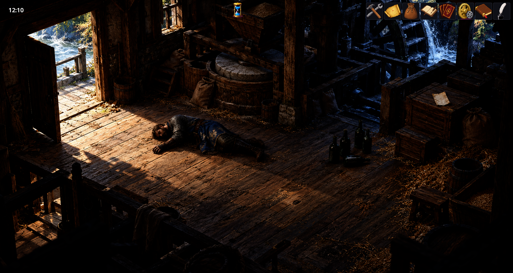

# Junior Reaper & Paper Grief — the Bureau's first case

Stas reaches the Bureau after an absurd death and receives the case of a guard who keeps dying. The separate game collection `junior_reaper_paper_grief` combines isometric outdoor maps with mouse-driven interior investigation. Russian is the main story language; full story translations are not implemented yet.

## Start and controls

From the main menu choose **Play**, **Junior Reaper & Paper Grief**, then a new game. From source: `godot --path . -- --game=junior_reaper_paper_grief --new`.

WASD/arrows walk, Shift runs, E/F talks or uses what the hero faces. Inside the mill and Lida's home there is no grid walking: these are background scenes with dialogs and clickable inspection areas. Click clues and exits. The journal explains the next step; the bag holds evidence.

## First-case walkthrough

1. Finish the introduction and receive the Bureau assignment.
2. Inspect the empty post at the gates, then find the mill. Inspect the body, bottles and note in any order; repeats do not duplicate evidence.
3. Return to the Bureau after all three clues and restore the guard. This is a selective world reset: inventory and investigation progress remain.
4. Speak to Gleb at the gates. After his refusal, question colleagues, the merchant and Lida, and observe the mill's cycle. These four steps can be completed in any order.
5. Agree on a solution with Gleb and Lida and report back. The case closes and repeat visits remain safe.

The two-day observation is a scripted time lapse, not a real-time wait. After restoration the mill shows an explicitly preserved investigation snapshot. Ambient conversations at the gates and market run while you walk; starting a regular conversation interrupts that participant's bark.

## Authoring and data

This content mod uses `rpg`, `dialog_base`, characters, items, quests and `npc_barks_base`. Its collection includes the map/object/character/item/scene/scenario/interactive/light/effect/data/translation editors and Scenario Studio.

`maps/` owns the RPG grids and invisible `Events`; `objects/` holds visible definitions and `placements/` their instances. `scenes/` links logical scenes and backgrounds; `interactives/` holds the interior inspection areas. Main programs are in `scenarios/jrp/`, ambient ones in `scenarios/jrp/ambient/`. Quest `jrp_guard_case` tracks stages 0–11; clue/action flags prevent repeated rewards. Preserve event identities to retain their `self.` flags across content updates.

The mod suites are `jrp_investigation` and `stas_lamp`. Standard subsystem save slots retain progress; background history belongs to `npc_barks_base`.
