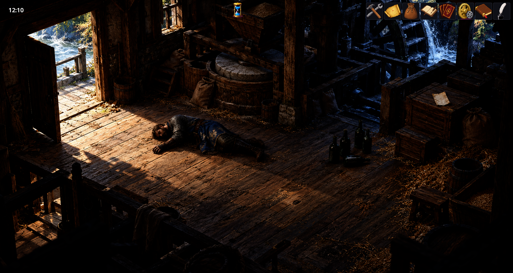

# Junior Reaper & Paper Grief — первое дело Бюро

Стас оказывается в Бюро после нелепой смерти и получает дело стражника Глеба, который умирает повторно. Это отдельная игра коллекции `junior_reaper_paper_grief`: изометрические улицы сочетаются с осмотром интерьеров мышью. Основной язык истории — русский; полные переводы истории пока не реализованы.

## Запуск и управление

В главном меню откройте **Играть**, выберите **Junior Reaper & Paper Grief** и начните новую игру. Из исходников: `godot --path . -- --game=junior_reaper_paper_grief --new`.

Ходьба — WASD или стрелки, Shift — бег, E/F — разговор или взаимодействие перед героем. В мельнице и доме Лиды ходьбы по клеткам нет: это обычные сцены с задником, диалогами и областями для мыши. Щёлкайте по уликам и выходам. Журнал подсказывает следующий шаг; инвентарь хранит находки.

## Как пройти первое расследование

1. Пройдите вступление и получите поручение в Бюро.
2. У ворот осмотрите пустой пост, затем найдите мельницу. Внутри исследуйте тело, бутылки и записку в любом порядке. Повторный осмотр не дублирует предметы.
3. После трёх улик вернитесь в Бюро и восстановите стражника. Инвентарь и расследование сохраняются; это выборочный сброс мира.
4. Поговорите с Глебом у ворот. После отказа опросите коллег, торговца и Лиду, затем наблюдайте за циклом у мельницы. Эти четыре шага доступны в свободном порядке.
5. Согласуйте решение с Глебом и Лидой и вернитесь с отчётом. Финал закрывает дело; повторные посещения безопасны.

Наблюдение двух дней оформлено сценарием и не требует ждать реальное время. После восстановления мельница показывает сохранённый слепок осмотра, а не текущее местонахождение живого Глеба. Фоновые реплики у ворот и на рынке идут независимо, пока вы идёте; обычный разговор прерывает реплику участника.

## Что может изменить автор

Игра — контентный мод поверх `rpg`, `dialog_base`, персонажей, предметов, квестов и `npc_barks_base`. Коллекция включает редакторы карты, объектов, персонажей, предметов, сцен, сценариев, интерактивов, света, эффектов, данных, переводов и студию сценариев.

`maps/` хранит RPG-карты и невидимые `Events`; `objects/` — видимые объекты, `placements/` — их расстановки. `scenes/` связывает логические сцены с задниками. `interactives/` описывает зоны осмотра интерьеров. Основные сценарии лежат в `scenarios/jrp/`, фоновые — в `scenarios/jrp/ambient/`. Квест `jrp_guard_case` хранит стадии 0–11; флаги улик и выполненных действий обеспечивают повторную безопасность. Не меняйте устойчивые ID событий без переноса их `self.`-флагов.

Проверки мода: `jrp_investigation` и `stas_lamp`. Сохранение игры использует обычные слоты подсистем, а история фоновых разговоров — слот `npc_barks_base`.
